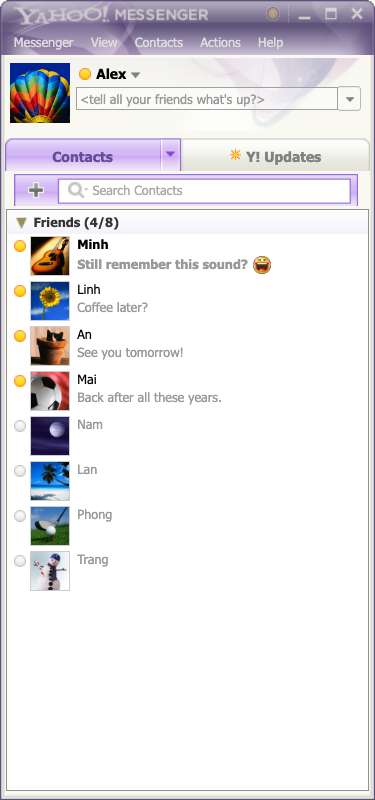
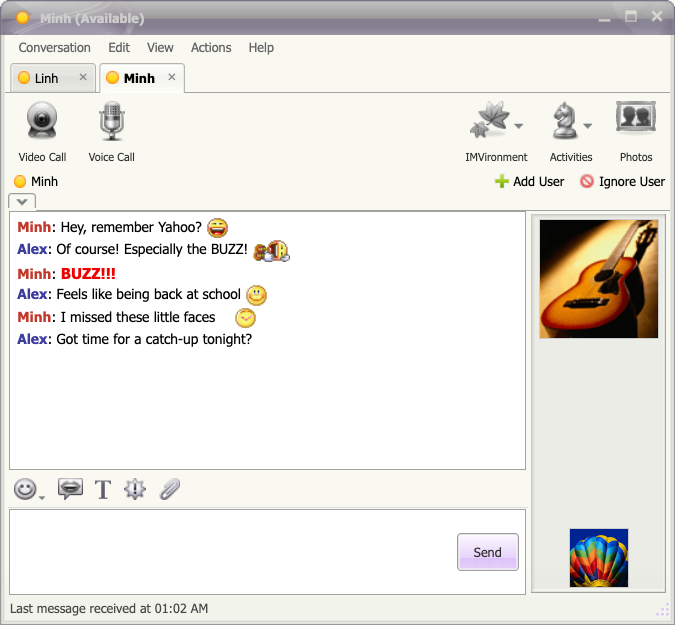
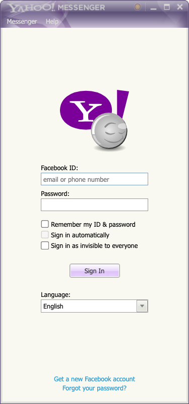

<p align="center">
  
</p>

<h1 align="center">Buzz! Messenger</h1>

> **Tiếng Việt:** Xem [README tiếng Việt](README.vi.md) và [hướng dẫn sử dụng](docs/HUONG-DAN.md).

Buzz! Messenger brings the **Yahoo! Messenger** experience back to the desktop: buddy lists, separate chat windows, emoticons, and the familiar BUZZ! sound.

It's for anyone who used Yahoo! Messenger and misses chatting that way. Sign in with Facebook and chat through Messenger; the person you're talking to doesn't need to install Buzz! Messenger.

## Download and install

Get a published installer from [GitHub Releases](https://github.com/saolabs/buzz-messenger/releases). These packages include the app and its runtime assets; you don't need Node.js, npm, or a source build.

| Computer | Choose |
| --- | --- |
| Windows, Intel/AMD 64-bit | `win-x64-setup.exe` or `win-x64-portable.exe` |
| Mac with Apple Silicon | `mac-arm64.dmg` or `mac-arm64.zip` |
| Mac with Intel processor | `mac-x64.dmg` or `mac-x64.zip` |
| Linux, Intel/AMD 64-bit | `linux-x64.AppImage` or `linux-x64.deb` |

Filenames start with `buzz-messenger-<version>-`. If no release is listed yet, the installers haven't been published. Maintainers can use the [release workflow guide, in Vietnamese](docs/PHAT-HANH.md).

## A look inside

| Buddy list | Conversation |
| --- | --- |
|  |  |

Screenshots show the app with sample contacts and messages, without a Facebook account connected.

<details>
<summary>Sign-in screen</summary>



</details>

## Familiar features

- A buddy list with avatars, accent-insensitive name search, and activity indicators when Messenger provides them.
- Separate chat windows, with an option to group conversations into tabs and detach them later.
- 12 classic skins, with purple as the default.
- 95 Yahoo emoticons, including shortcuts such as `:))`, `=))`, `:-*`, and `>:D<`.
- BUZZ! window shaking, message sounds, and flashing tabs for incoming messages.
- Text messaging, image and sticker viewing, and voice message playback.
- Vietnamese and English interfaces, with separate controls for zoom and text size.

BUZZ! is sent through Messenger as the text `BUZZ!!!`. Buzz! Messenger recognizes it and plays the sound and window effect; regular Messenger displays the text. Emoticon shortcuts are also sent as text and rendered as Yahoo icons inside Buzz! Messenger.

## Current status

The project is under development at version `0.1.0`, with real Messenger sign-in and messaging connected. It uses Electron, React, and TypeScript, reading and interacting with Messenger's web interface through embedded Chromium. It doesn't require a separate Buzz! Messenger server.

Video/voice calling, file sending, IMVironment, Activities, and some other classic controls currently have a visual presence only. Choose **Conversation → Open in Messenger** to use Messenger features that aren't available in the app.

The development log records testing on macOS. Windows and Linux packaging targets are configured, but runtime behavior on those platforms hasn't been confirmed. Sync depends on Facebook's web interface and may need adjustments when Messenger changes.

## Run from source

You need **Node.js 22 LTS, version 22.13 or later in that release line**, npm, and a desktop environment that can run Electron. Linux also needs an OS key store, such as GNOME Keyring or KWallet, to open the vault.

Runtime assets live in `resources/ym/` and are included with the project. From the project directory, run:

```sh
npm ci
npm run dev
```

Python 3 and the original Yahoo installer are only needed to regenerate assets. See the [asset workflow](docs/PHAT-TRIEN.md#tài-nguyên-giao-diện).

Sign in to Facebook in the app. If Facebook requests verification or a history recovery PIN, complete the prompt in the Messenger window that opens. See the [usage and troubleshooting guide, in Vietnamese](docs/HUONG-DAN.md).

## Local data

Account details, cookies, saved PINs, and conversation history are stored in an AES-256-GCM encrypted vault. Electron's `safeStorage` protects the vault key. The app refuses to open the vault without an available key store and has no plaintext storage fallback.

**Remember** controls whether the password and cookies are retained after a normal exit. Signing out clears the app session's cookies; the password is retained only if Remember was selected. See [storage and session details, in Vietnamese](docs/HUONG-DAN.md#du-lieu-va-phien-dang-nhap).

## Development

```sh
npm run typecheck
npm test
npm run build
```

Available packaging configurations:

| Command | Formats |
| --- | --- |
| `npm run dist:mac` | DMG, ZIP |
| `npm run dist:win` | NSIS, portable |
| `npm run dist:linux` | AppImage, DEB |

Packaging copies the runtime assets from `resources/ym/`; it doesn't use `_extracted/`. See the [development guide, in Vietnamese](docs/PHAT-TRIEN.md) for architecture, tests, and the asset workflow.

## Documentation

The detailed guides are currently in Vietnamese:

- [User guide](docs/HUONG-DAN.md): sign-in, messaging, customization, and troubleshooting.
- [Development](docs/PHAT-TRIEN.md): code structure, data flow, checks, and packaging.
- [Releases](docs/PHAT-HANH.md): build installers on GitHub Actions and publish downloads.
- [Ideas and decisions](docs/Y-TUONG.md): product direction, asset sources, and implementation notes.

## Credits and assets

Buzz! Messenger is an independent SaoLabs project inspired by Yahoo! Messenger. It isn't an official Yahoo or Meta product.

The skins, emoticons, logos, and sounds extracted from the Yahoo installer remain Yahoo assets. The repository excludes the installer and `_extracted/`; the current prototype uses these assets for a personal nostalgic experience. Changing the letter on the app icon doesn't change the assets' origin. Public distribution calls for assets with appropriate usage rights or newly created replacements.

The logo and interface screenshots in `docs/images/` illustrate the current app and use those same visual assets.

The package currently declares `UNLICENSED`; no open source license has been published for the project.
