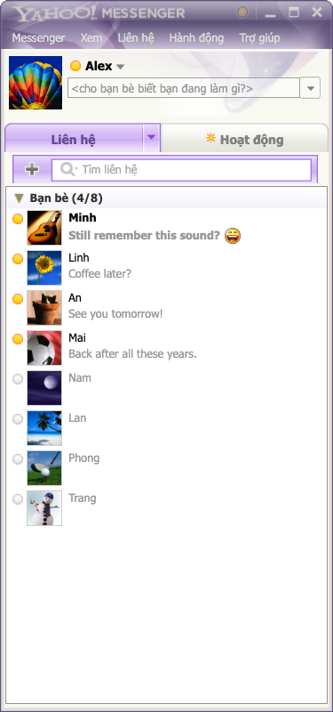
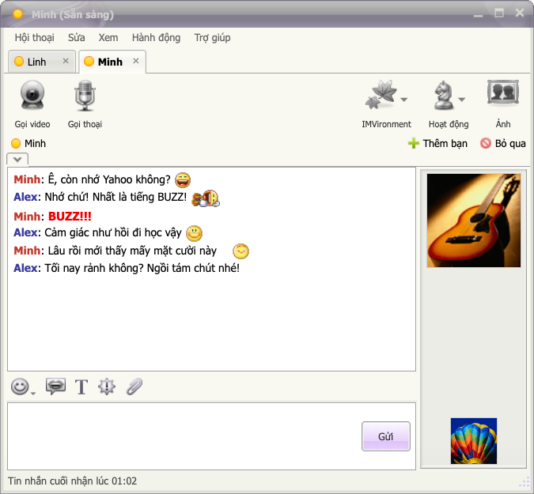
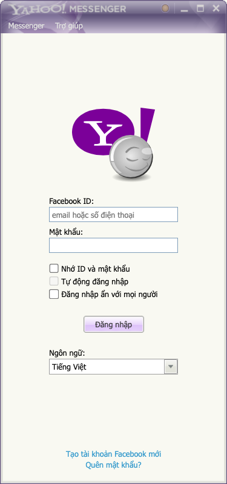

<p align="center">
  
</p>

<h1 align="center">Buzz! Messenger</h1>

[English](README.md) | **Tiếng Việt**

Buzz! Messenger mang trải nghiệm **Yahoo! Messenger** trở lại trên desktop: danh sách bạn bè, cửa sổ chat riêng, emoticon và tiếng BUZZ! quen thuộc.

Dự án dành cho những ai từng dùng Yahoo! Messenger và muốn tìm lại cảm giác nhắn tin ngày ấy. Bạn đăng nhập bằng Facebook và trò chuyện qua Messenger; người bên kia không cần cài Buzz! Messenger.

## Tải và cài đặt

Tải bộ cài đã công bố tại [GitHub Releases](https://github.com/saolabs/buzz-messenger/releases). Bộ cài chứa sẵn ứng dụng và tài nguyên runtime; bạn không cần Node.js, npm hoặc tự build.

| Máy tính | Chọn file |
| --- | --- |
| Windows, Intel/AMD 64-bit | `win-x64-setup.exe` hoặc `win-x64-portable.exe` |
| Mac Apple Silicon | `mac-arm64.dmg` hoặc `mac-arm64.zip` |
| Mac Intel | `mac-x64.dmg` hoặc `mac-x64.zip` |
| Linux, Intel/AMD 64-bit | `linux-x86_64.AppImage` hoặc `linux-amd64.deb` |

Tên file bắt đầu bằng `buzz-messenger-<version>-`. Nếu chưa thấy bản Release, bộ cài chưa được công bố. Người phát triển xem [hướng dẫn phát hành](docs/PHAT-HANH.md).

Từ `0.1.1`, bản thử nghiệm macOS được ký ad-hoc và chưa notarize. Gatekeeper vẫn có thể yêu cầu cho phép mở bản tải từ Internet; xem [hướng dẫn cài macOS](docs/HUONG-DAN.md#macos-chặn-mở-ứng-dụng). Thay bản macOS `0.1.0` vì bản đó có chữ ký không hợp lệ.

## Giao diện

| Danh sách bạn bè | Cửa sổ chat |
| --- | --- |
|  |  |

Ảnh chụp giao diện ứng dụng với tên và tin nhắn mẫu, không kết nối tài khoản Facebook.

<details>
<summary>Màn hình đăng nhập</summary>



</details>

## Những điều quen thuộc

- Buddy list với avatar, tìm kiếm không dấu và trạng thái hoạt động khi Messenger cung cấp.
- Mỗi người một cửa sổ chat, hoặc gom hội thoại thành tab rồi tách ra khi muốn.
- 12 skin cổ điển, mặc định là tông tím quen thuộc.
- 95 emoticon Yahoo với các mã gõ như `:))`, `=))`, `:-*`, `>:D<`.
- BUZZ! rung cửa sổ, âm báo tin nhắn và tab nhấp nháy khi có tin đến.
- Đọc, gửi tin nhắn văn bản; xem ảnh, sticker và nghe tin thoại.
- Gửi tệp/ảnh bằng nút đính kèm hoặc kéo thả, có khay xem trước khi gửi.
- Tải thêm danh bạ/lịch sử, tìm liên hệ qua Messenger; nhóm có biệt danh tác giả, bảng thành viên và mở chat riêng đúng người.
- Tiếng Việt và English; chỉnh độ phóng giao diện và cỡ chữ riêng.

BUZZ! được gửi qua Messenger dưới dạng chữ `BUZZ!!!`. Người dùng Buzz! Messenger nhận tin này sẽ thấy hiệu ứng rung và nghe âm thanh; trên Messenger thông thường, người nhận thấy chữ. Mã emoticon cũng được gửi dưới dạng văn bản và hiển thị thành icon Yahoo trong Buzz! Messenger.

## Tình trạng hiện tại

Dự án đang ở giai đoạn phát triển, phiên bản `0.2.1`. Luồng đăng nhập và nhắn tin Messenger thật đã được nối; ứng dụng dùng Electron + React + TypeScript, đọc và thao tác trên trang Messenger bằng Chromium nhúng, không cần server riêng của Buzz! Messenger.

Nút gọi video/thoại mở đúng hội thoại trong cửa sổ Messenger nhúng và kích hoạt nút gọi tương ứng. Cho phép camera/microphone khi hệ điều hành yêu cầu. Luồng này đã được kiểm tra bằng dữ liệu giả lập; âm thanh/hình ảnh cuộc gọi thật vẫn cần thử với người nhận.

Thanh soạn có âm thanh vui đi kèm và định dạng chữ cục bộ; Messenger nhận văn bản thuần. IMVironment, Activities và một số công cụ cổ điển hiện chỉ có giao diện. Chọn **Hội thoại → Mở trong Messenger** để dùng những chức năng Messenger chưa được đưa vào app.

Ứng dụng đã được thử trên macOS theo nhật ký phát triển. Windows và Linux có cấu hình đóng gói nhưng chưa được xác nhận qua thử nghiệm thực tế. Việc đồng bộ phụ thuộc giao diện web của Facebook và có thể cần sửa khi Messenger thay đổi.

## Chạy từ mã nguồn

Cần **Node.js 22.13 trở lên thuộc nhánh 22 LTS**, npm và môi trường desktop chạy được Electron. Linux cần kho khóa hệ điều hành, chẳng hạn GNOME Keyring hoặc KWallet, để mở vault.

Tài nguyên cần để chạy app nằm trong `resources/ym/` và được giữ cùng dự án. Chạy trong thư mục dự án:

```sh
npm ci
npm run dev
```

Python 3 và bộ cài Yahoo gốc chỉ cần khi tạo lại tài nguyên. Xem [quy trình tài nguyên](docs/PHAT-TRIEN.md#tài-nguyên-giao-diện).

Đăng nhập Facebook trong app. Nếu Facebook yêu cầu xác minh hoặc PIN khôi phục lịch sử, hoàn tất trong cửa sổ Messenger được mở ra. Xem [hướng dẫn sử dụng và xử lý sự cố](docs/HUONG-DAN.md).

## Dữ liệu trên máy

Thông tin tài khoản, cookie, PIN đã lưu và lịch sử hội thoại được lưu trong vault mã hóa AES-256-GCM; khóa vault được bảo vệ bằng `safeStorage` của Electron. Ứng dụng từ chối mở vault khi không có kho khóa phù hợp, không chuyển sang lưu dạng văn bản thuần.

Tùy chọn **Remember** quyết định việc giữ mật khẩu và cookie sau khi thoát bình thường. Đăng xuất xóa cookie của phiên trong app; mật khẩu chỉ được giữ nếu đã chọn Remember. Chi tiết về lưu trữ và giới hạn nằm trong [hướng dẫn](docs/HUONG-DAN.md#du-lieu-va-phien-dang-nhap).

## Phát triển

```sh
npm run typecheck
npm test
npm run build
```

Trong môi trường desktop, các lệnh `npm run test:calls`, `test:composer`, `test:pagination`, `test:search` và `test:groups` kiểm tra tích hợp Electron bằng Messenger giả lập ngoại tuyến. Không gọi/gửi tin/tệp thật và không mở camera/microphone.

Các cấu hình đóng gói hiện có:

| Lệnh | Định dạng |
| --- | --- |
| `npm run dist:mac` | DMG, ZIP |
| `npm run dist:win` | NSIS, portable |
| `npm run dist:linux` | AppImage, DEB |

Đóng gói lấy tài nguyên từ `resources/ym/`, không phụ thuộc `_extracted/`. Xem [tài liệu phát triển](docs/PHAT-TRIEN.md) để hiểu kiến trúc, bộ kiểm tra và quy trình tài nguyên.

## Tài liệu

- [Hướng dẫn sử dụng](docs/HUONG-DAN.md): đăng nhập, chat, tùy chỉnh và xử lý sự cố.
- [Phát triển](docs/PHAT-TRIEN.md): cấu trúc mã nguồn, luồng dữ liệu, kiểm tra và đóng gói.
- [Phát hành](docs/PHAT-HANH.md): build bộ cài bằng GitHub Actions và công bố bản tải về.
- [Kế hoạch tiếp theo](docs/ROADMAP.md): thứ tự ưu tiên và tiêu chí hoàn thành sau v0.2.1.
- [Ý tưởng và quyết định](docs/Y-TUONG.md): định hướng sản phẩm, nguồn tài nguyên và nhật ký triển khai.

## Ghi nhận và tài nguyên

Buzz! Messenger là dự án độc lập của SaoLabs, lấy cảm hứng từ Yahoo! Messenger; không phải sản phẩm chính thức của Yahoo hoặc Meta.

Skin, emoticon, logo và âm thanh được trích từ bộ cài Yahoo vẫn là tài nguyên của Yahoo. Repository bỏ qua bộ cài và thư mục `_extracted/`; bản thử nghiệm hiện dùng các tài nguyên này cho trải nghiệm cá nhân. Việc đổi chữ trên icon không thay đổi nguồn gốc của các tài nguyên. Hướng phát hành công khai cần bộ tài nguyên có quyền sử dụng phù hợp hoặc được vẽ lại.

Logo và ảnh giao diện trong `docs/images/` minh họa ứng dụng hiện tại, sử dụng các tài nguyên hình ảnh nói trên.

Package hiện khai báo `UNLICENSED`; dự án chưa công bố giấy phép mã nguồn mở.
